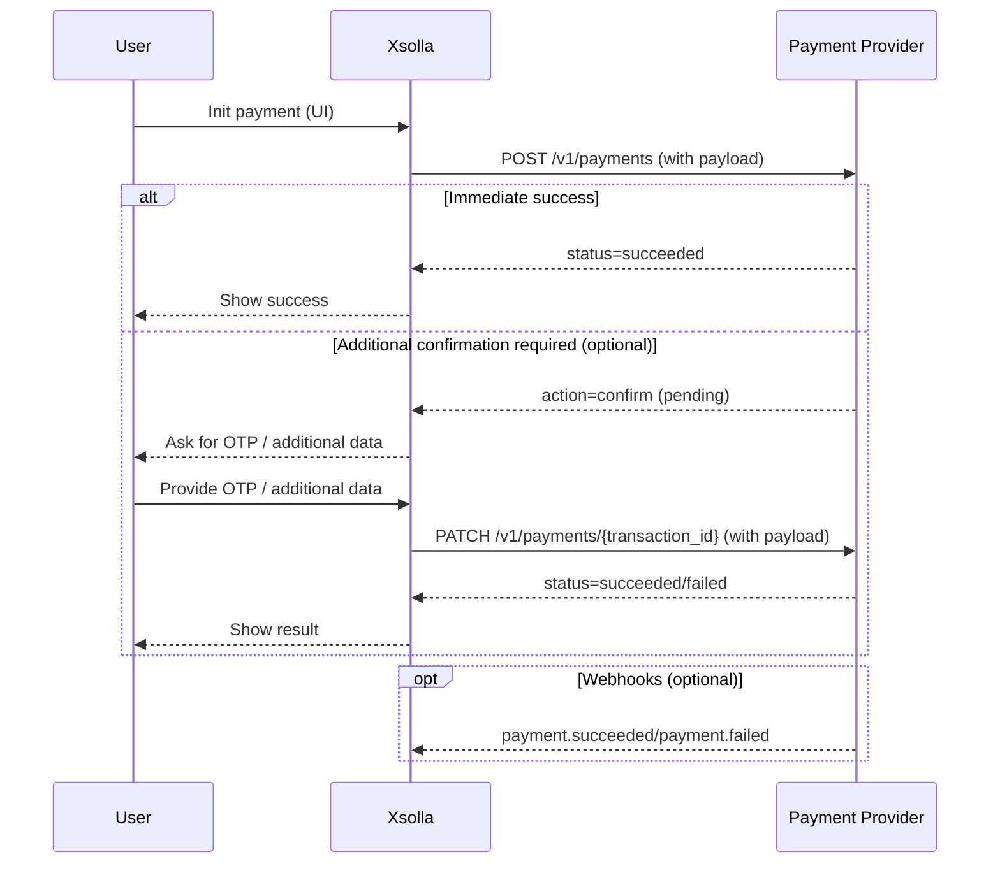
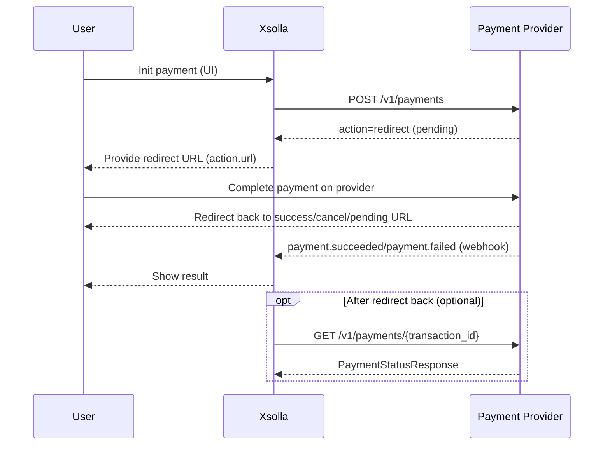
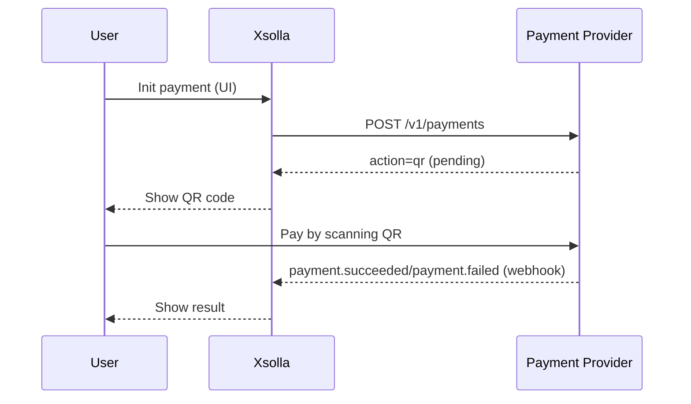
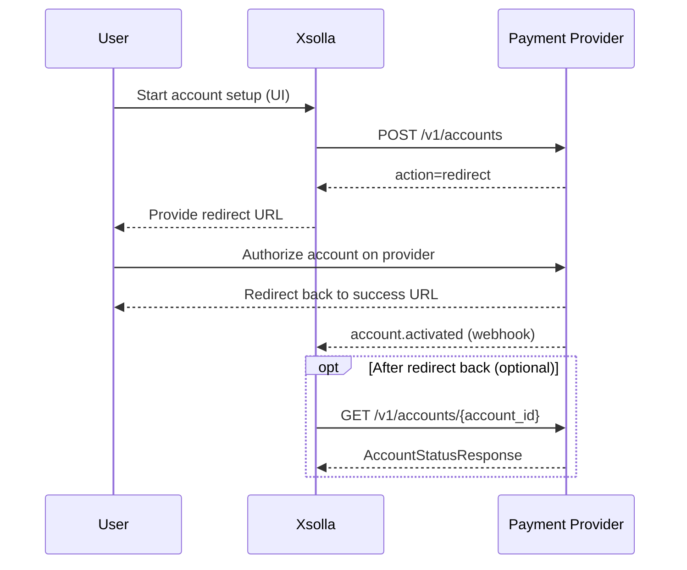
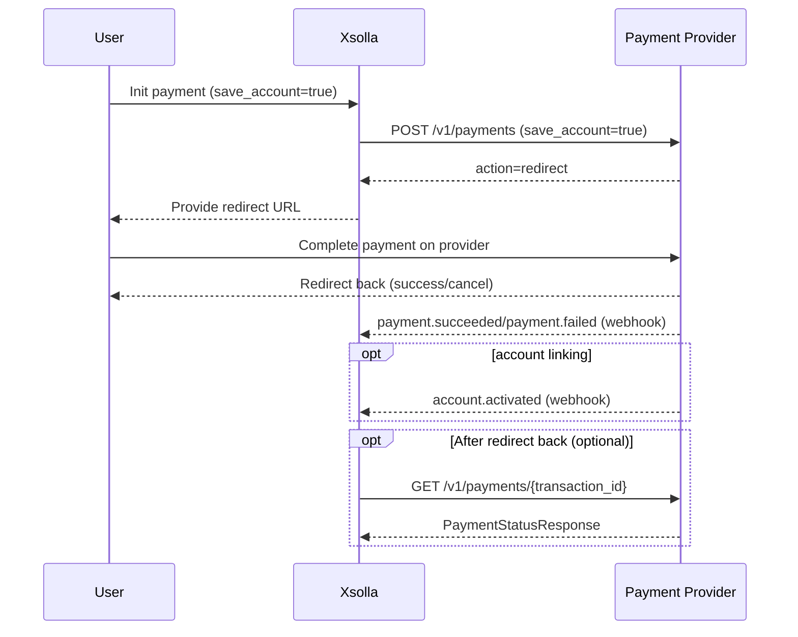

# Payment Providers Integration Guide

This document describes the API specification that payment providers should implement on their side to integrate with the Payments API.
The provider-side implementation can be a proxy service to an existing provider API or a new service built specifically for this contract.

## Overview

- All synchronous API calls (e.g., `POST /v1/payments`) are sent by Xsolla to the provider.
- Payment providers must implement REST endpoints to receive these requests, verify HTTP Message Signatures, and respond according to the API contract.
- Payment providers must also be able to send webhook requests back to Xsolla (e.g., status notifications), signed with HTTP Message Signatures.

## Security and Signing

We use:
- HTTP Message Signatures (RFC 9421)
- Content-Digest (RFC 9530)

Secrets are managed per provider account. The `keyid` identifies both the secret on Xsolla side and the associated provider account.
Signing key and its `keyid` are issued by the Xsolla integration manager and are provided to the provider upon request.

### Headers

Incoming requests from Xsolla will include:
- `Request-Id` (required)
- `Content-Digest` (required for requests with body)
- `Signature-Input` (required)
- `Signature` (required)
- `Prefer` (internal, optional): environment="sandbox"

Payment providers must return these headers for outgoing webhooks to Xsolla as well, following the same rules.

### Verification steps (incoming requests)

1. Obtain the shared secret by `keyid`.
2. Validate `created`/`expires` time window.
3. Verify `Content-Digest` against the raw request body (when present).
4. Reconstruct signature base per `Signature-Input` and verify `Signature` using HMAC-SHA256.
5. Correlate `Request-Id` in logs for tracing.

### Example `Signature-Input`

```
sig1=("@method" "@target-uri" "content-digest" "request-id");alg="hmac-sha256";created=1700000000;expires=1700000600;keyid="acc_123"
```

## Endpoints to implement (minimum)

- `POST /v1/payments` — accept payment creation and return the `action` object according to the OpenAPI spec.
- `PATCH /v1/payments/{transaction_id}` — confirm when `action.type=confirm` is returned.
- `POST /v1/refund/{transaction_id}` — create a refund (optional; only if supported by the provider).
- `GET /v1/payments/{transaction_id}` — provide current status.

## Webhooks to Xsolla

Payment providers send webhooks to Xsolla using the `urls.webhook` from the creation request.

Headers:
- `Request-Id` (required)
- `Content-Digest` (required for requests with body)
- `Signature-Input` (required)
- `Signature` (required)

Events and payloads (top-level fields, no data wrapper):
- `payment.succeeded`: `type`, `occurred_at`, `transaction_id`, optional `method`, `id`, `amount`, `account_data`, `errors[]`
- `payment.failed`: `type`, `occurred_at`, `transaction_id`, optional `method`, `id`, `amount`, `reason`, `errors[]`
- `payment.refunded`: `type`, `occurred_at`, `transaction_id`, `amount`, optional `method`, `reason`, `refund_id`
- `account.activated`: `type`, `occurred_at`, `account_id`, `account_data`
- `account.deleted`: `type`, `occurred_at`, `account_id`

Delivery:
- At-least-once with retries on 5xx/timeout.
- 2xx means ACK; consumer must handle idempotently.

## Idempotency

- Use `Idempotency-Key` when applicable.

## Sequence diagrams

### 1) White label



### 2) Redirect



### 3) QR



### 4) Create payment method via redirect



### 5) Pay and create payment method (redirect + webhooks)



## Error handling

- Follow error formats from the OpenAPI spec. Errors include `code`, `category`, and `message`, with optional `param`, `retry_after`, `doc_url`.
- Common codes: `invalid_request`, `invalid_param`, `authentication_required`, `permission_denied`, `rate_limited`, `idempotency_conflict`, `transaction_not_found`, `processor_declined`, `timeout`, `internal_error`.
- For signature failures, return `401 Unauthorized` with a generic message.

## Testing

- Use the Prism mock server to emulate responses.
- Validate Signature and Content-Digest locally before deploying.
